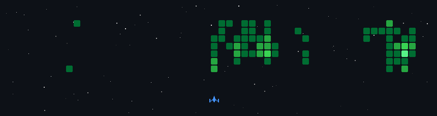

# Hi, I'm Ashwin

Incoming Software Engineer at Runpod (January 2027). Finishing my MS in ECE at Purdue in December. I work on LLM inference and data infrastructure.

### What I've built

- **[emberserve](https://github.com/ashwinsreedhar28/emberserve)**: LLM inference engine from scratch. Paged KV cache, prefix caching, continuous batching, OpenAI-compatible server. Matches vLLM throughput on the same GPU, and cold-starts in 17 s on Runpod Serverless vs ~130 s for worker-vllm.
- **[worker-vllm #351](https://github.com/runpod-workers/worker-vllm/pull/351)** (merged): persists vLLM's torch.compile cache on the network volume, taking 40–60 s off Serverless cold starts. Shipped in v2.29.0.
- **[serverless-lakehouse](https://github.com/ashwinsreedhar28/serverless-lakehouse)**: medallion pipeline over my Runpod Serverless data. Built on Spark + Delta, ported to Snowflake + dbt with all 8 gold tables matching row for row, with the Runpod API as a live source. [Dashboard](https://huggingface.co/spaces/ashwin-sreedhar/serverless-lakehouse)
- **[Pulse](https://github.com/ashwinsreedhar28/Pulse)**: local-first news and market monitoring desktop app, ~50k lines of TypeScript (Electron, React, SQLite) with local and hosted LLM scoring.
- **[Aether](https://github.com/ashwinsreedhar28/Aether)**: multi-agent personal AI platform with voice control, signed messages between nodes, and graph-based authorization.

### Stack

Python · TypeScript · SQL · PyTorch · vLLM · Spark · Delta Lake · Snowflake · dbt · Docker · Kubernetes · Runpod Serverless

Previously Platform Developer at E&J Gallo.

[LinkedIn](https://www.linkedin.com/in/ashwinsreedhar) · ashwin.sreedhar2003@gmail.com

